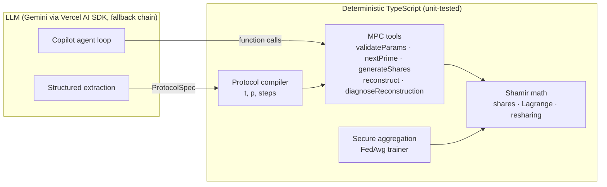

# Shamir MPC Visualizer

An interactive web application that simulates and visualizes Shamir secret sharing for summation and multiplication (resharing). Built with Next.js, TypeScript, and Tailwind CSS.

## Features

- **Interactive Control Panel**: Set parameters (prime p, n players, threshold t, secrets a and b, RNG seed)
- **Polynomial Generation**: Automatically generates f(x) and g(x) and computes shares
- **Player Grid Visualization**: Each player displays their shares f(i), g(i), h_sum(i), h_prod(i)
- **Step-through Flow**: Play/Pause/Next/Prev controls for educational walkthrough
- **Summation Protocol**: Local sum computation and Lagrange reconstruction
- **Multiplication with Resharing**: Local product → resharing animation → T(j) aggregation → reconstruction
- **Math Inspector**: Modal showing Lagrange interpolation details with KaTeX rendering
- **Secure RNG**: Uses crypto.getRandomValues() for secure randomness
- **Input Validation**: Prime validation and parameter checks

## AI & Privacy-Preserving ML Features

| Page         | What it does                                                                                                                                                                                                                              |
| ------------ | ----------------------------------------------------------------------------------------------------------------------------------------------------------------------------------------------------------------------------------------- |
| `/federated` | **Federated learning with Shamir secure aggregation.** Clients train logistic regression locally; their updates are secret-shared, summed share-wise and only the total is reconstructed. Tolerates clients dropping out after sharing.   |
| `/copilot`   | **Cryptography Copilot.** An LLM agent (Vercel AI SDK, function calling) that verifies (t, n) parameters and root-causes failed reconstructions. All math runs in deterministic tools; the model only chooses tools and explains results. |
| `/nl-to-mpc` | **Natural language → MPC protocol.** The LLM extracts facts from a plain-English requirement into a typed spec; a deterministic compiler picks t and p, validates them and emits protocol steps plus a "Run in Visualizer" link.          |



### Measured results

- **Federated learning** (5 clients, t=3, 30 rounds, non-IID): 94.5% test accuracy for both secure and plaintext FedAvg; max aggregation error 2×10⁻⁵ (fixed-point rounding only); unchanged with 1–2 clients offline per round.
- **NL-to-MPC**: 15/15 labelled requirements compiled correctly (validity, n, t, operation, p), including two infeasible ones that must be rejected; median extraction latency 9.7s (`scripts/eval-nl-to-mpc.mjs`). The set is small and self-written.
- **Copilot**: locates a corrupted share among 5 and still recovers the secret; chains `validateParams → nextPrime → validateParams` to repair unsafe parameters.

### Setup

Copy `.env.example` to `.env` and set `GEMINI_API_KEY` (free key from Google AI Studio). Optional:

- `AI_MODELS`: comma-separated fallback chain (default `gemini-3.5-flash,gemini-3.5-flash-lite,gemini-flash-lite-latest`). On 429/404/5xx/timeout the next model answers.
- `AI_ATTEMPT_TIMEOUT_MS`: time a model may take to start answering before falling back (default 30000).
- `AI_RATE_LIMIT_PER_HOUR`: LLM requests per signed-in user per hour (default 30).

AI routes require sign-in. Run the extraction eval against a running dev server with:

```bash
node --env-file=.env scripts/eval-nl-to-mpc.mjs
```

## Getting Started

### Prerequisites

- Node.js 20+ and npm

### Installation

```bash
npm install
```

### Development

```bash
npm run dev
```

Open [http://localhost:3000](http://localhost:3000) to see the app.

### Build

```bash
npm run build
npm start
```

### Testing

```bash
# Run all tests
npm run test

# Run tests in watch mode
npm run test:watch
```

### Linting & Formatting

```bash
# Run ESLint
npm run lint

# Format code with Prettier
npm run format

# Check formatting
npm run format:check
```

## Project Structure

```
shamir-secret/
├── src/
│   ├── app/                    # Next.js App Router
│   │   ├── visualizer/         # Shamir MPC visualizer
│   │   ├── federated/          # Federated learning demo
│   │   ├── copilot/            # Cryptography Copilot chat
│   │   ├── nl-to-mpc/          # Natural language → protocol
│   │   └── api/                # Auth, docs, copilot, nl-to-mpc routes
│   ├── components/             # React components (incl. LineChart, SafeMarkdown)
│   └── lib/
│       ├── math/               # Core math: shamir, polynomial, lagrange, resharing
│       ├── fl/                 # Fixed-point encoding, dataset, model, secure aggregation, FedAvg
│       ├── mpc/                # Deterministic tools, protocol schema and compiler
│       ├── ai/                 # Model config, fallback chain, copilot tools, error mapping
│       └── server/             # Auth, MongoDB, rate limiting, Cloudinary
├── scripts/                    # NL-to-MPC eval cases and runner
├── tests/                      # Jest unit tests (math, fl, mpc tools, compiler, fallback, …)
├── .vscode/                    # VSCode settings
├── jest.config.js
├── tsconfig.json
├── next.config.ts
└── package.json
```

## Example Usage

### Basic Summation Example

1. Set parameters: p=11, n=7, t=3, a=4, b=2
2. Click "Generate" to create shares
3. Use Stepper to walk through summation protocol
4. See reconstruction of a+b (mod p)

### Multiplication with Resharing

1. Set same parameters as above
2. Step through to multiplication phase
3. Watch animated resharing between players
4. See T-shares aggregation and final reconstruction of a×b (mod p)

## Security Notes

- Uses `crypto.getRandomValues()` for secure random number generation
- Prime validation before computation
- BigInt arithmetic for all modular operations
- Input sanitization and bounds checking

## Development Workflow

This project follows a phased development approach:

- **Phase 0**: Project setup ✅
- **Phase 1**: Core math library with tests ✅
- **Phase 2**: Basic UI & control flow ✅
- **Phase 3**: Multiplication resharing visualization ✅
- **Phase 4**: Math inspector & KaTeX ✅
- **Phase 5**: Tests, polish, export ✅

## Tech Stack

- **Framework**: Next.js 16 (App Router)
- **Language**: TypeScript 5
- **Styling**: Tailwind CSS 4
- **Animations**: Framer Motion
- **Math Rendering**: KaTeX
- **AI**: Vercel AI SDK v7 (`streamText` agent loop, `Output.object` structured output), Google Gemini, zod
- **Data**: MongoDB (users, sessions, rate limits)
- **Testing**: Jest + ts-jest
- **Linting**: ESLint (Next.js recommended config)
- **Formatting**: Prettier

## Contributing

1. Follow the atomic task list in phases
2. Ensure all tests pass before committing
3. Run linter and formatter
4. No `any` types without documented justification

## License

MIT
